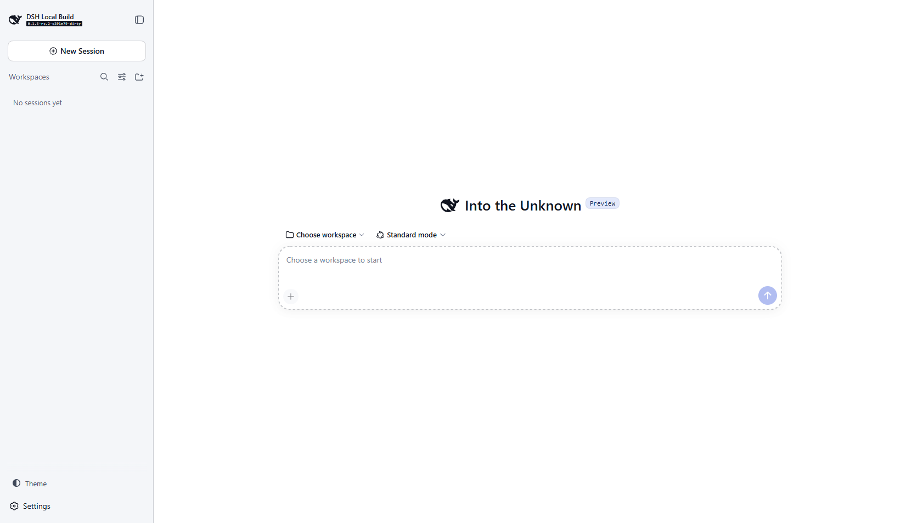
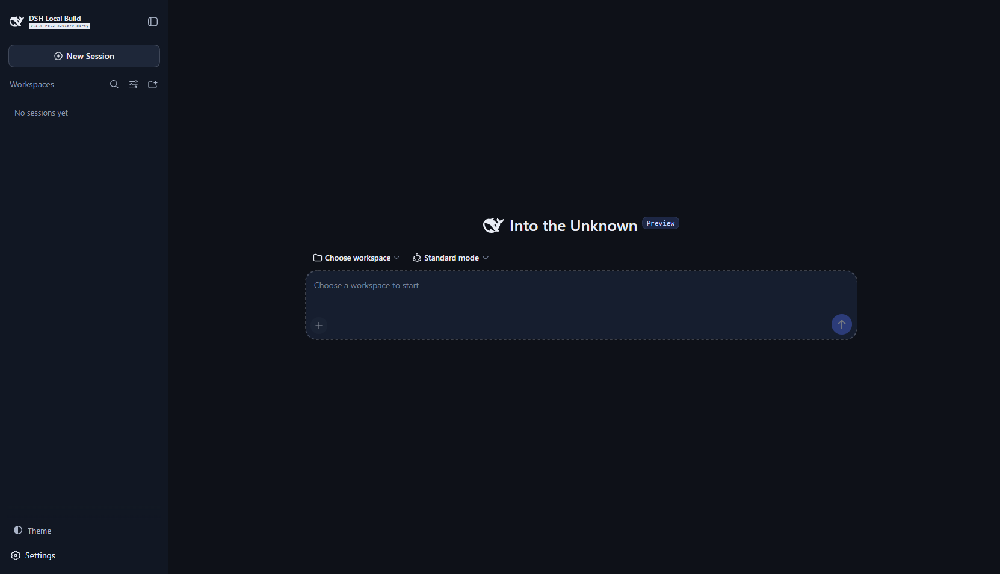

<div align="center">

# Deep Contrast

**A restrained, high-contrast light & dark theme for [DeepSeek Harness](https://github.com/deepseek-ai/deepseek-harness).**

One deliberate palette. Two variants of the same design system. A single half-shaded circle to switch between them.

[](LICENSE)
[](https://github.com/deepseek-ai/deepseek-harness)
[](#contributing)

| Light | Dark |
| --- | --- |
|  |  |

</div>

## Why Deep Contrast

Most themes are a pile of colors. Deep Contrast is a small set of rules:

- **Contrast with intent.** Primary text clears 15:1 against its surface in both modes; every color still used for reading text meets WCAG AA (4.5:1) or better.
- **One accent.** A single deep indigo carries interactivity — links, focus, selection, primary buttons. State colors (error, success, warn) appear only as states.
- **Two variants, one system.** Light and dark are the same semantic palette re-tuned for their base: identical roles, identical hierarchy, the same indigo lifted for the darker surface.
- **Nothing neon.** Muted-but-distinct syntax colors, hairline borders, no gradients, no glows, no color riot.

The result feels intentional rather than decorated — clarity first, decoration nowhere.

## What it recolors

| Surface | Covered |
| --- | --- |
| Backgrounds, layers, overlays, scrims | ✓ |
| Text ladder (primary → captions) | ✓ |
| Borders, scrollbars, hovers, focus | ✓ |
| Buttons, links, selection | ✓ |
| Sidebar, composer, menus, toasts, tooltips | ✓ |
| Markdown/code blocks + syntax highlighting | ✓ |

Deep Contrast recolors through the Harness's semantic alias layer only, so every Harness component keeps behaving exactly as designed.

## Install

Inside any DeepSeek Harness checkout:

```sh
pnpm dsh plugin --profile web add github:temidayoxyz/deep-contrast
```

Then start (or restart) the web UI:

```sh
pnpm dsh web
```

That's it — the plugin is self-contained: no configuration, no extra tooling, nothing else to install. Removing it restores the stock palette:

```sh
pnpm dsh plugin --profile web remove dsh-deep-contrast
```

## Switching themes

- **Toggle:** click the half-shaded circle at the foot of the sidebar, next to Settings. One button serves both directions — it always switches to the opposite scheme. In the narrow sidebar rail it collapses to the icon alone.
- **Default:** until you use the toggle, the UI follows your operating system's light/dark preference.
- **Settings:** Harness → Settings → General → Appearance (Light / Dark / System) stays fully functional — Deep Contrast layers its palette over whichever mode is active rather than replacing the switcher.

Your choice persists across restarts (Harness user settings), and switching never requires a reload.

## Configuration

None. Deep Contrast is intentionally a pure palette. To tune it, fork and edit one file: [`src/palette.ts`](src/palette.ts) — every role carries a light and a dark value side by side.

## Development

```sh
pnpm install      # dev dependencies: tsdown, typescript, react types
pnpm build        # build lib/ (host entry + browser client bundle)
pnpm typecheck    # tsc --noEmit
```

Layout:

```
src/
  palette.ts        # the semantic color system — light + dark values per role
  tokens.ts         # exhaustive role → --dsw-* token mapping (one override layer)
  index.ts          # host entry (mounts the package on the Loader)
  harness-types.ts  # structural types for the runtime-provided Harness faces
  client/
    index.ts        # plugin body: palette layer + toggle registration
    ContrastToggle.tsx
    theme-store.ts  # external-store bridge over the Harness theme runtime
    styles.ts       # the toggle's stylesheet (token-driven)
    locales.ts      # en/zh copy
```

To try changes against a running Harness:

```sh
pnpm build
pnpm dsh web --patch D:/path/to/deep-contrast/cordis.patch.yml --no-open
```

## Contributing

Issues and pull requests are welcome. Please keep changes inside the design rules above — restraint is the feature: if a color needs explaining, it probably doesn't belong. Palette changes must include both the light and dark values for every touched role.

## License

[MIT](LICENSE)
